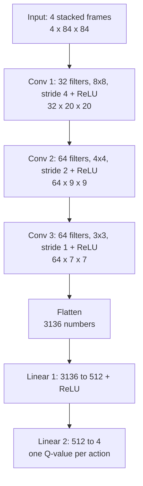
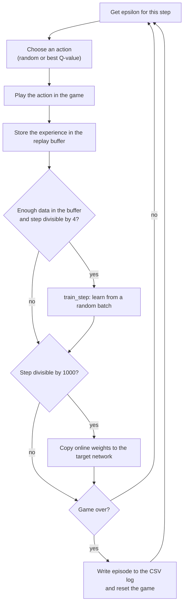

# DQN on Atari Breakout

## 1. Introduction

In this project we teach a computer to play the Atari game **Breakout** by itself, using **Deep Q-Learning (DQN)**.

In Breakout the player moves a paddle left and right to bounce a ball and break bricks. The agent is never told
the rules. It only sees the screen and receives a **reward** each time a brick breaks. By playing thousands of
games and learning from its mistakes, it slowly learns where to put the paddle.

Everything is written by us in Python with PyTorch. We did **not** use any ready-made DQN library.

## 2. Members

| Member | Name | Part |
|---|---|---|
| Member 1 | [add name] | Repository, setup, environment, main training loop (`train.py`) |
| Member 2 | [add name] | Neural network (`q_network.py`) and live demo (`play.py`) |
| Member 3 | [add name] | Replay buffer, training step, task allocation sheet |
| Member 4 | [add name] | Epsilon-greedy, plots, README, final check |

Each member also ran 10 experiments with different hyperparameters. The models and the results table are in the
member's own folder.

## 3. Environment

We use `ALE/Breakout-v5` from Gymnasium (Arcade Learning Environment).

| Item | Value |
|---|---|
| Observation | the game screen |
| Actions | 4: do nothing, fire (start the ball), move right, move left |
| Reward | +1 or more for each brick broken (we clip it to -1, 0 or +1 for training) |
| Episode | one game, it ends when the player loses all lives |

The raw screen is big and colourful, so `make_env()` in `train.py` simplifies it:

1. **Grayscale**: colour is not needed.
2. **84 x 84 pixels**: smaller image, faster learning.
3. **Frame skip of 4**: the agent chooses an action every 4 frames and repeats it. The game moves little in one frame.
4. **Stack of 4 frames**: one picture cannot show which way the ball moves, four pictures in a row can.

So the agent always sees an input of shape **4 x 84 x 84**.

## 4. Architecture

The network (`QNetwork` in `q_network.py`) looks at the 4 stacked frames and gives **one Q-value per action**.
A Q-value is the score the network predicts for an action: "how much reward can I expect if I do this now?"
The agent picks the action with the highest Q-value.



| Layer | Type | Output shape |
|---|---|---|
| Input | 4 stacked grayscale frames (pixels divided by 255) | 4 x 84 x 84 |
| 1 | Conv2d(4, 32, kernel 8, stride 4) + ReLU | 32 x 20 x 20 |
| 2 | Conv2d(32, 64, kernel 4, stride 2) + ReLU | 64 x 9 x 9 |
| 3 | Conv2d(64, 64, kernel 3, stride 1) + ReLU | 64 x 7 x 7 |
| 4 | Flatten | 3136 |
| 5 | Linear(3136, 512) + ReLU | 512 |
| 6 | Linear(512, 4) | 4 (Q-values) |

The network has about 1.69 million parameters. It starts from random weights (no pretrained model).

## 5. How the training works

### The main idea

The network starts knowing nothing, so its Q-values are random. We play, store what happens, and repeatedly
adjust the network so that its Q-values become closer to what really happened.

### The loop (`train.py`)



### The 5 ideas behind it

**1. Epsilon-greedy (explore or exploit)**
At the start the network knows nothing, so the agent must try things. With probability **epsilon** it plays a
random action (explore), otherwise it plays the action with the best Q-value (exploit). Epsilon starts high and goes
down in a straight line, so the agent explores a lot first and then uses what it has learned:

```
epsilon = eps_start + (eps_end - eps_start) * (step / eps_decay)     until step = eps_decay
epsilon = eps_end                                                    after that
```

Example with the defaults (1.0, 0.05, 100000): at step 0 epsilon is 1.0 (always random), at step 50,000 it is
0.525, from step 100,000 it stays at 0.05 (5% random). This is `epsilon_by_step` and `select_action` in `train.py`.

**2. Replay buffer** (`replay_buffer.py`)
Every step is stored as `(state, action, reward, next_state, done)`. When we learn, we take a **random batch**
from the memory instead of the latest steps. Consecutive frames are almost identical, so learning from them in order
is unstable. Random old experiences make learning much steadier. The buffer keeps the last 50,000 steps.

**3. Online network and target network**
We have two copies of the same network. The **online** network is the one we train. The **target** network is a
frozen copy used only to compute the goal we train towards. Every 1,000 steps we copy the online weights into the
target. Without this, the network would chase a goal that moves after every update.

**4. The Bellman target** (`train_step.py`)
For each experience in the batch, the goal for the Q-value of the action taken is:

```
target = reward + gamma * (best Q-value of the next state, from the target network) * (1 - done)
```

- **gamma** (0.99) says how much we care about future rewards compared to immediate ones.
- `(1 - done)` is 0 when the game just ended, because there is no future after the end.

**5. Loss and update** (`train_step.py`)
We compare the network's Q-value with the target using the **Huber loss** (like MSE for small errors, but less
sensitive to big ones). Then we do `zero_grad`, `backward` and `step` with the **Adam** optimizer. This moves
the weights so the network's prediction gets closer to the target.

### Default settings

| Setting | Value |
|---|---|
| Training length | 300,000 steps |
| Replay buffer size | 50,000 |
| Learning starts after | 5,000 steps (buffer is filled with mostly random play first) |
| Learning step | once every 4 game steps |
| Target network update | every 1,000 steps |
| Learning rate (`--lr`) | 1e-4 |
| Gamma (`--gamma`) | 0.99 |
| Batch size (`--batch-size`) | 32 |
| Epsilon start / end / decay (`--eps-start`, `--eps-end`, `--eps-decay`) | 1.0 / 0.05 / 100,000 |

## 6. Experiments

Each member ran 10 experiments, changing the hyperparameters one at a time (learning rate, gamma, batch size,
epsilon start, end and decay). In each member's folder you will find:

- `expNN_model.pth`: the saved model of experiment NN
- `expNN_log.csv`: the log of that run (episode, total steps, episode length, reward, epsilon)
- `<Name>Hyperparameter_experiment_results.md`: the table of the 10 experiments and what we observed

The plots of the **best experiment** are in the `plots/` folder. The best model is also copied to the root of the
repo as `dqn_model.pth`, and this is the one `play.py` loads.

<!-- After choosing the best experiment, show its plot here, for example:

-->

## 7. Demo video

[Watch the demo video](ADD-VIDEO-LINK-HERE)

## 8. How to run

We use **uv** only. Install it from <https://docs.astral.sh/uv/>, then from the repo folder:

```bash
# 1. Install everything (first time only)
uv sync

# 2. Train one experiment (all arguments are optional)
uv run train.py --lr 1e-4 --gamma 0.99 --batch-size 32 --eps-start 1.0 --eps-end 0.05 --eps-decay 100000 --name YourName_exp01

# 3. Watch the trained agent play (needs dqn_model.pth in the repo root)
uv run play.py

# 4. Plot the best experiment (or give a log file: uv run plot_results.py Tonny/exp03_log.csv)
uv run plot_results.py

# 5. Check that the repo is complete
uv run check_repo.py
```

`--name` must look like `MemberName_expNN`. The model and the log are saved in the folder `MemberName/`.

## 9. Repository structure

```
train.py                 main training loop, make_env, epsilon_by_step, select_action
play.py                  load dqn_model.pth and watch the agent play live
q_network.py             QNetwork (the neural network)
replay_buffer.py         ReplayBuffer
train_step.py            train_step (one learning step)
test_train_step.py       test: the loss goes down on a fixed batch
plot_results.py          plots of one experiment (reward, episode length, steps)
check_repo.py            final check of the repo
dqn_model.pth            the best model
pyproject.toml           dependencies (uv)
Task allocation sheet.pdf   who did what
<MemberName>/            10 models, 10 logs and the results table of that member
plots/                   plots of the best experiment
```
